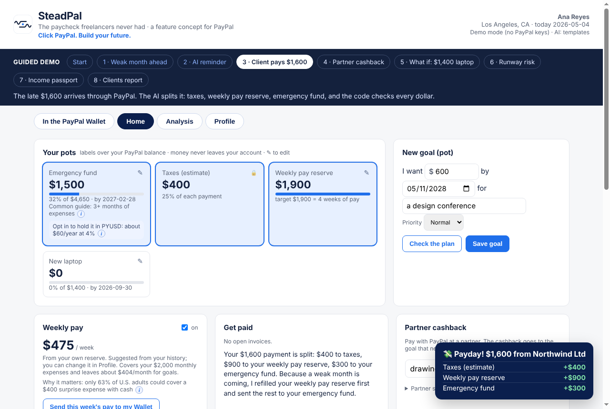
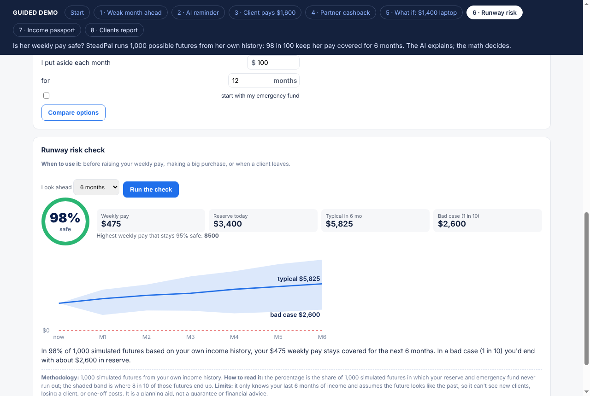
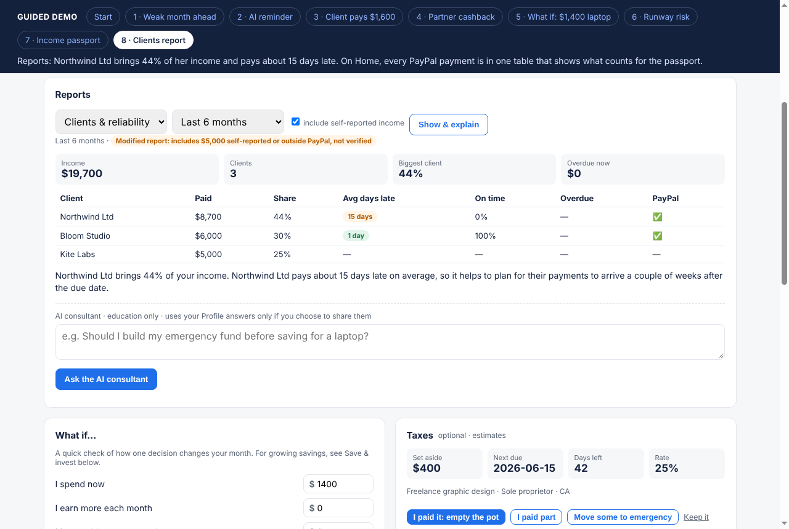
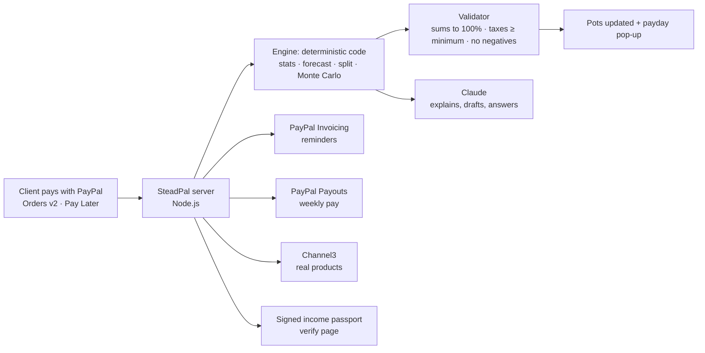

# SteadPal

**The paycheck freelancers never had. A feature concept for PayPal.**

*Click PayPal. Build your future.* Every dollar through PayPal works for you.

**Live demo:** https://steadpal.onrender.com. Free hosting, so the first visit can take up to a minute to wake up. Click **Guided demo** at the top: 8 steps, about 2 minutes.



> Hackathon prototype for the PayPal AI Hackathon (2026). It uses simulated data and the PayPal sandbox. It is for education only and is not financial, tax or investment advice.

---

## The problem

64 million Americans (38% of the workforce) did freelance work in 2023 ([Upwork, Freelance Forward 2023](https://www.upwork.com/research/freelance-forward-2023-research-report)). Their income moves around (Ana, our demo user, earned $3,500 in March and $800 in April), but rent stays the same. No employer sets money aside for their taxes, emergencies or a steady paycheck. Many are paid through PayPal, but the money lands in a single balance with no plan.

## The idea

SteadPal is a tab inside the PayPal Wallet. It turns every PayPal payment into a plan:

- **It splits each payment** into pots: taxes, a weekly pay reserve, an emergency fund and goals.
- **It sees weak months coming**, from ended contracts and late invoices.
- **It pays the user a steady weekly amount** from their own reserve.
- **It routes partner cashback and round-ups** to the goal that needs them most.
- **It gives an income passport** that a landlord can verify.

No new app and no lending: the money never leaves PayPal.

Built for freelancers, useful for anyone with a goal.

---

## What it does

### In the PayPal Wallet (concept view)
- One balance, shown split into **Available to spend** and labelled pots. Nothing leaves the Wallet: a client pays, SteadPal labels it, and on payday "Send this week's pay to my Wallet" moves the weekly pay from the reserve label to Available.
- **SteadPal on/off switch.** Before turning it off, the user sees the risks (tax money becomes spending money, weekly pay stops, the emergency cushion is no longer kept apart). Turning it off returns all pot money to Available, and PayPal works exactly as before; goals, settings and the last pot values are kept, and can be restored when SteadPal is turned back on. Turning it on opens a **setup sheet** where the user chooses: tax set-aside, weekly pay, reserve weeks, emergency target, a share of each payment kept available, where extra money goes, and up to 5 goals. Every option is a dropdown with suggestions plus "Custom".
- The same preferences live in **Profile → SteadPal preferences** and can be changed anytime.
- Clearly labelled as a concept illustration, not a real PayPal page.

### Home
| Feature | What the user sees |
| --- | --- |
| **Pots** | Labels over the PayPal balance: emergency fund, taxes, weekly pay reserve, goals. The money never moves. One **Edit pots** button: pick any pot (except Taxes) to rename, retarget, duplicate or delete it. Every new goal becomes a new pot. |
| **Smart split + payday pop-up** | A client pays $1,600 through PayPal, which becomes $400 taxes, $900 weekly pay reserve and $300 emergency fund, with a one-sentence reason. Code checks every dollar. |
| **AI late-invoice reminder** | Claude drafts a polite reminder for an overdue invoice. The user edits and sends it, through the **PayPal Invoicing API** when keys are set. |
| **Weekly pay** (optional) | A steady amount from the user's own reserve (PayPal Payouts), never above what their history supports. |
| **Partner cashback** (Channel3) | Search real products, pay with PayPal, and the cashback goes to the goal most behind, not to the wallet. Optional **round-ups** to the next $1, $5 or $10. |
| **Goals** | "I want $___ by ___ for ___", with a priority. Shows whether it fits after higher-priority goals and, if not, when it would. |
| **Income passport** (optional) | A signed one-page certificate (download as PDF) with facts from PayPal commercial payments only, a verification code and a 30-day link. It always states how much income came from the largest 1 and 2 clients, without naming them, so income from one or two friends can't pass as a business. If the holder allows it, a viewer can ask about those clients from the verification page, and the holder decides what to share. |
| **Other income (self-reported)** | Add one payment, or import many from a CSV file or pasted rows (exported from a bank or another app; no new connections). Always labelled self-reported and never counted in the passport. |
| **PayPal transactions** (AG Grid) | Every payment, sortable and filterable, with a "counts for passport" column. |

### Analysis
| Feature | What the user sees |
| --- | --- |
| **Next month forecast** | "Heads up: next month may be low. Bloom Studio's retainer ended and Northwind is 21 days late. Your $475 weekly pay is protected." Every number links to the data behind it: each month, each payment and each step of the math. The user can leave out an unusual month, and everything recalculates. |
| **Reports + AI consultant** | Income, Clients & reliability (average days late, income share), Cash flow, Taxes and Goals. Periods: last month, 3, 6, 12 or 24 months, last calendar year, or custom months. Self-reported income can be included; the report is then labelled as modified. Each report is explained by Claude, and an AI consultant answers questions using only the user's numbers. |
| **What if** | "I spend $X now, earn $Y more a month, or my costs go up $Z." Shows free money per month, when the emergency fund is ready, whether the weekly pay still covers costs, and the purchase as a share of the cushion. |
| **Taxes** (optional) | Amount set aside, next due date, and the user's choice: paid (empty the pot), paid part, move some to the emergency fund, or keep. |
| **Save & invest education** | Compares the PayPal balance, savings, a 12-month CD, a 3-month Treasury bill and PYUSD: projected interest, protection, access and risk. Illustration only. The Treasury rate refreshes from FRED on the user's schedule (daily, weekly or monthly). |
| **Runway risk check** | 1,000 simulated futures from the user's own history give the chance the weekly pay stays covered, a typical and a bad case, and the highest weekly pay that stays 95% safe. |



### Profile: the user decides every number
- **Your numbers:** rent, fixed expenses, weekly pay, reserve weeks and the emergency fund target. SteadPal only suggests (for example "3 months of rent" or "2.3 months of expenses for your level of irregularity"). Gentle notes appear, such as "it looks like you may be overstretching", but nothing blocks a save.
- **Business & taxes:** business type, tax type, state, the user's own set-aside rates, and payment dates (add or delete).
- **Help the AI know you (optional):** comfort with risk, kind of work, typical number of clients, slow months, priorities and explanation style. These are shared with the AI consultant only if the user switches sharing on. Nothing sensitive is asked: no ID or account numbers, health or family details.
- **Other income (self-reported):** income outside PayPal is shown as self-reported. It is included in reports only with a "modified report" label, and never counted in the income passport.
- **Round-ups** on or off.

### Sources behind every fact
Small **i** buttons open the source of each fact: Upwork (freelancers), Federal Reserve SHED 2025 (63% could cover a $400 emergency with cash), CFPB (emergency savings guidance, income dips), IRS Publication 334 (15.3% self-employment tax), FDIC ($250,000 insurance), PayPal (PYUSD rewards).



---

## How it works



**Principle: the AI explains, the code calculates and verifies, and the user decides.** Every number comes from deterministic code (`engine/core.js`, `engine/analysis.js`). Claude only explains decisions, drafts reminders and answers questions, using the numbers it is given. If the AI is unavailable, the app falls back to fixed templates and keeps working.

### Engine highlights
- **Reserve target:** 1 + 3 × the coefficient of variation of income, between 1 and 6 months of expenses. More irregular income means a bigger cushion.
- **Safe weekly pay:** covers fixed expenses and is never above 90% of the after-tax average, rounded to $25.
- **Forecast:** low / expected / high, with named reasons (ended retainers, overdue invoices).
- **Runway risk:** bootstrap Monte Carlo (1,000 paths, seeded so the demo is repeatable) over the last 6 months of after-tax income. An overdue invoice arrives in month 1 with 85% probability.
- **Passport:** counts only PayPal commercial payments (invoices, goods and services) from verified payers that are not linked to the user and have accounts at least 30 days old. It is signed with HMAC-SHA256 and shows facts only, never a score.

### PayPal APIs used (sandbox)
| API | Used for |
| --- | --- |
| JavaScript SDK + Orders v2 | The client pays an invoice (PayPal or **Pay Later**); purchases at partner merchants |
| Invoicing v2 | Create, send and remind for overdue invoices |
| Payouts | Optional weekly pay from the user's reserve |
| Transaction Search | Payment history for statistics and the passport (planned for live data) |
| Webhooks | Payment notifications (endpoint in place; signature verification is a TODO) |

### AI (Claude, Anthropic API)
- Explanations for every decision, report wording, late-invoice reminders and the AI consultant.
- The system prompt is strict: use only the numbers provided, education only, no investment recommendations, and treat client text (names, memos) as data, never as instructions.
- Only amounts, dates and categories are sent to the model, never emails or account details.
- `GET /api/ai/check` reports whether the AI connection works.

### Official rates (`data/rates.json`)
| Option | Rate | Source |
| --- | --- | --- |
| Savings account (national average) | 0.38% | FDIC National Rates, Aug 2026 |
| 12-month CD (national average) | 1.71% | FDIC National Rates, Aug 2026 |
| 3-month Treasury bill | 4.21% | Federal Reserve H.15 via FRED DGS3MO, Nov 2, 2026 |
| PYUSD reward (variable, US only, not FDIC-insured) | 4.00% | PayPal PYUSD Rewards, Oct 26, 2026 |

---

## Partner technologies
- **Render:** hosting, with auto-deploy from GitHub.
- **Channel3:** real product search for partner cashback (`channel3.js`). The cashback is a share of the store's commission, so it costs PayPal nothing. Without a key, demo products are shown.
- **AG Grid Community:** the transactions table, loaded from jsDelivr. A plain table is shown if the CDN is unreachable.

---

## Run it

Requirements: Node.js 20 or newer. There are no packages to install.

```bash
git clone https://github.com/pammab/steadpal
cd steadpal
npm test          # engine checks
npm start         # open http://localhost:3000
```

Without keys the app runs in **demo mode**: buttons simulate payments, and explanations use templates.

### Environment variables (locally or in Render)
| Variable | Where to get it |
| --- | --- |
| `PAYPAL_CLIENT_ID`, `PAYPAL_CLIENT_SECRET` | developer.paypal.com → Apps & Credentials → Sandbox app (enable Invoicing and Payouts under Features) |
| `PAYPAL_PAYOUT_RECEIVER` | Email of a sandbox personal test account (receives weekly pay and, by default, invoices) |
| `PAYPAL_INVOICE_RECIPIENT` | Optional; a different sandbox email for invoices |
| `ANTHROPIC_API_KEY` | console.anthropic.com |
| `STEADPAL_MODEL` | Optional; Claude model name (default `claude-sonnet-5-5`) |
| `CHANNEL3_API_KEY` | trychannel3.com → Dashboard → API keys |
| `CASHBACK_RATE` | Optional; share of the price returned as cashback (default 0.03) |
| `PASSPORT_SECRET` | Any long random string (signs income passports) |

**Deploy on Render:** New → Web Service → connect this repo → no build command → start command `node server.js` → add the variables above.

---

## Limitations
- Simulated data in the sandbox only. Storage is in memory, so it resets on restart.
- The cashback rate is an estimate, because Channel3's search response does not include commission data.
- Pots are labels over one balance; real sub-accounts would need PayPal.
- Forecasts and the runway check assume the future looks like the last 6 months. They show ranges, not guarantees.
- Tax amounts are user-chosen estimates, not tax advice.
- PYUSD rewards are variable and US-only, and PYUSD is not FDIC-insured.
- Webhook signature verification is not implemented yet.
- The income passport is designed to stay within existing rules (issued from PayPal's own records, facts only, user-initiated, expiring), but it would need legal review before launch. Collusion between payer and payee cannot be fully prevented, as with a bank statement.

## Roadmap
- Live data through Transaction Search, plus Log in with PayPal for consent.
- Pay Later on every invoice, so clients can spread the payment while freelancers get paid in full now.
- SteadPal for Venmo and gig workers.
- Emerging markets: PYUSD payouts for freelancers abroad and family-support pots through Xoom, with licensed partners.
- An agent mode: SteadPal acts only with the user's approval (send invoices, move money between pots).

## License
MIT. See `LICENSE`.
